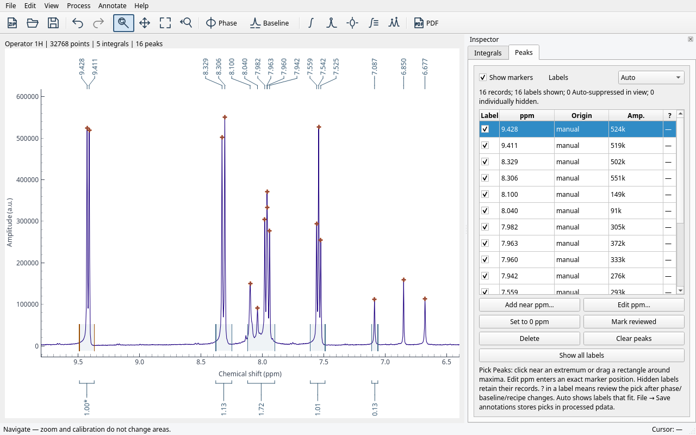
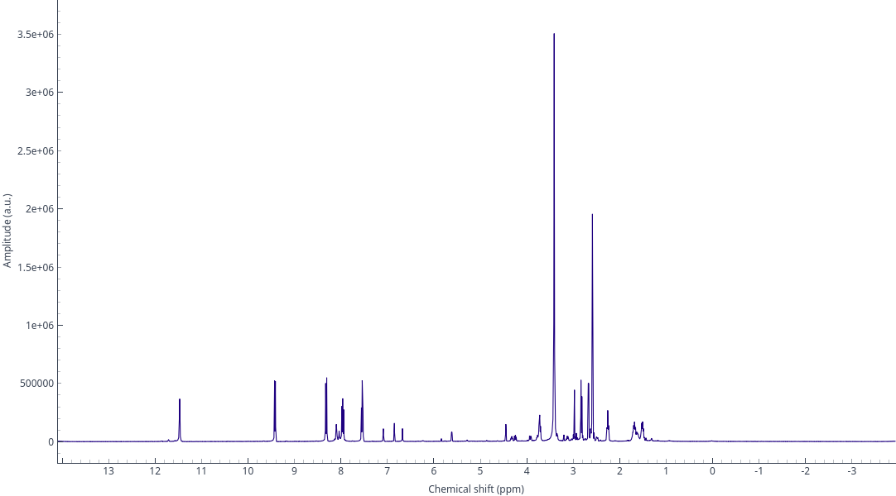

# 1H-NMR-Go

NMR-go is a desktop app for working with Bruker ¹H NMR spectra. Open a ZIP or
experiment folder, check the spectrum, integrate signals, and export a PDF.
Created by Alexander Novichkov for everyday work at the chemistry bench.

## Get started

- **Windows 11 x64.** Download the Windows ZIP from [Releases](https://github.com/AlexNovich/1H-NMR-Go/releases), extract the whole archive, and open `NMR-go.exe`. Keep the `_internal` folder beside it.
- **Linux.** Follow the [installation guide](docs/LINUX.md) to run NMR-go from source.

Spectrum processing takes place on your computer. You can work offline after installation.

## Try it with a spectrum

Download [this Bruker 1H-NMR example](examples/bruker-1h-example.zip), then choose
**File → Open ZIP** in NMR-go. The screenshots on this page use that same real
measurement. Try zooming into a crowded region and dragging a rectangle in **Pick Peaks**
to label the maxima.

NMR-go can display Bruker-processed data or process a raw FID. You can preview
phase and baseline corrections, integrate signals, pick peaks, and save the
current view as a vector PDF. **Save annotations** writes peaks and integrals to
processed Bruker data. If the input is a ZIP, NMR-go asks where to save an extracted
copy. See [annotation saving and recovery](docs/ANNOTATION_SAVE.md).

## License and support

The application source and its documentation are under the [MIT License](LICENSE).
The example and screenshots are provided for trying the app. You may share the
complete official Windows ZIP under the [binary distribution terms](TERMS.md).
Third-party notices accompany the Windows package.

If something goes wrong, include the NMR-go version, what you did and the
exact error. Use the downloadable example where possible.

## Acknowledgments

Thanks to ChatGPT 6.1 Sol, ChatGPT 6.2 Sol, Gemini Argon, and Claude Opus 5.5
for help with development and review.
